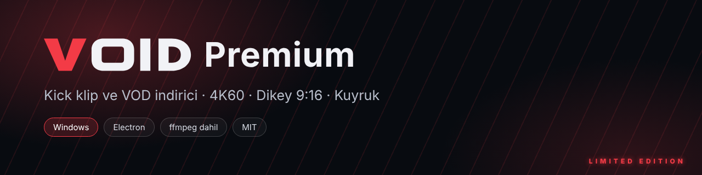
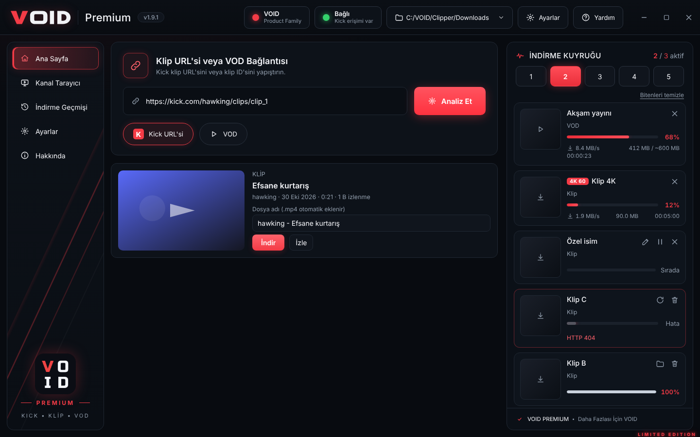
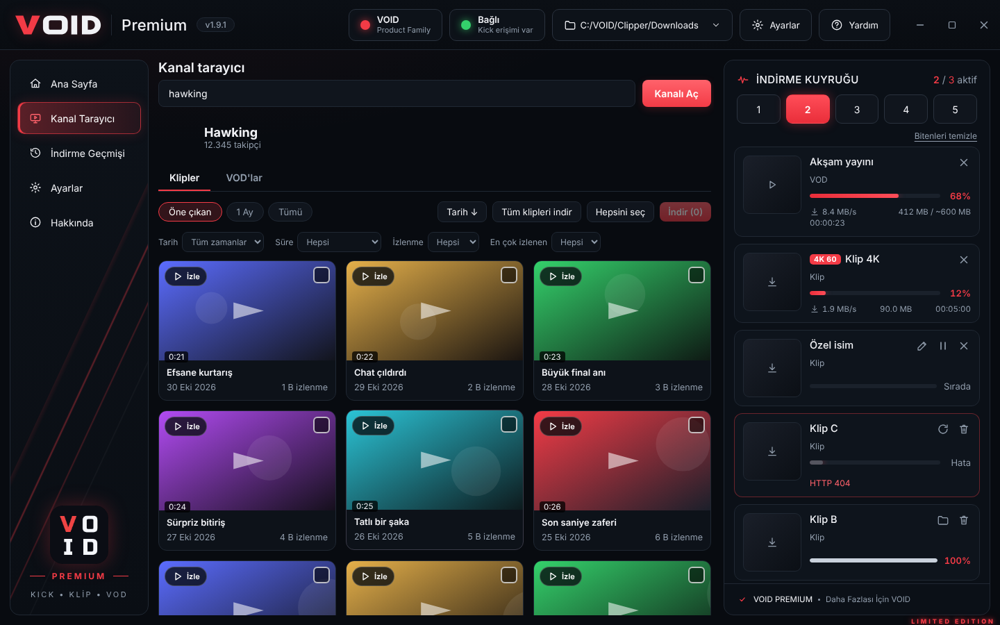
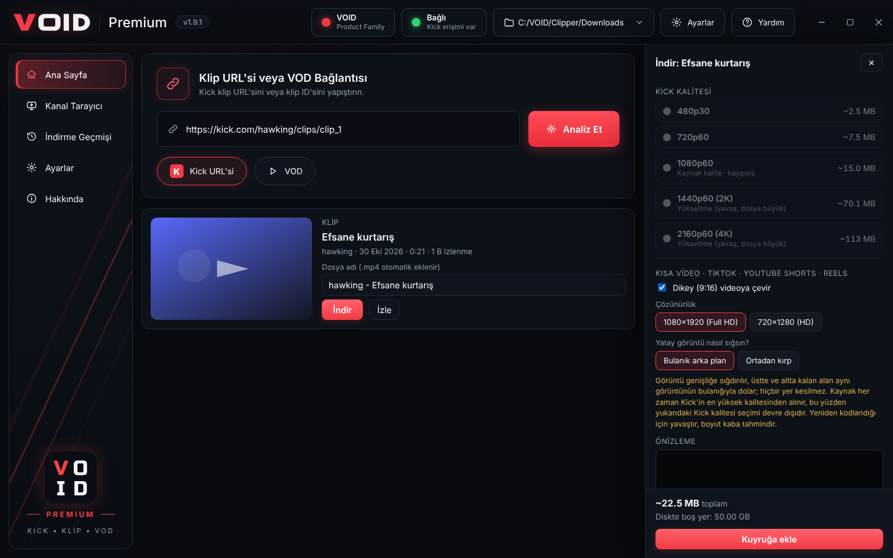
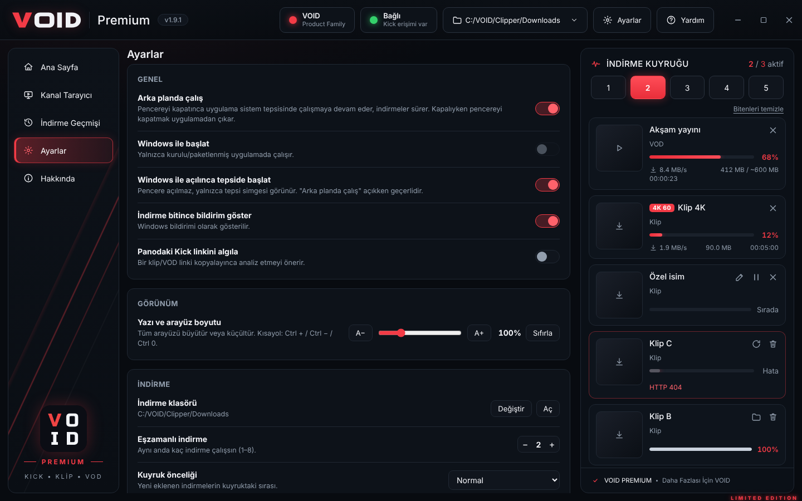

  

  <b>Kick klip ve VOD indirici</b> · Windows masaüstü uygulaması 
  Kalite seçimi, 4K 60 fps yükseltme, TikTok / Shorts için dikey çıktı, kalıcı indirme kuyruğu.

  
  
  
  

  <a href="VOID-Premium-Setup.zip"><b>⬇ Kurulum dosyasını indir (VOID-Premium-Setup.zip)</b></a>

---

## Ekran görüntüleri

| Ana sayfa | Kanal tarayıcı |
| --- | --- |
|  |  |

| Kalite ve dikey format | Ayarlar |
| --- | --- |
|  |  |

> Ekran görüntülerindeki başlıklar ve küçük resimler örnek veridir.

## Özellikler

- **Klip ve VOD indirme:** Kick linkini yapıştır ya da bir kanalı aç, istediğini seç.
- **Kalite seçimi:** Kaynağın tüm kaliteleri (1080p60, 720p60, 480p…) düşükten yükseğe sıralı ve her biri için **tahmini boyut**.
- **4K 60 / 2K 60 / 1080p60 yükseltme:** Kick'in sunduğundan yüksek çıktı (gerçek detay eklemez, bunu uygulama da belirtir).
- **Kısa video (TikTok · YouTube Shorts · Reels):** 1080×1920 veya 720×1280 dikey çıktı, *bulanık arka plan* ya da *kırp* (sol – orta – sağ konumu sen seçersin). Aynı bölümden aralığı **GIF** olarak da kaydedebilirsin.
- **Uygulama içinde izle:** Klipleri ve VOD'ları indirmeden önce oynatıcıda izle.
- **Bölüm kırpma:** Videonun yalnızca istediğin aralığını indir; önizlemede o anı başlangıç/bitiş yap, kareyi PNG kaydet.
- **Kanal tarayıcı:** Tarih, süre, izlenme ve "en çok izlenen N" filtreleri, toplu seçim, "tüm klipleri indir".
- **Kalıcı kuyruk:** Paralel indirme (1–8), öncelik, duraklat/iptal/tekrar dene, hız sınırı; uygulamayı kapatsan da kaldığı yerden sürer.
- **Pano algılama ve sürükle-bırak:** Kick linki kopyalayınca ya da pencereye bırakınca analiz önerir.
- **Arka planda çalışma:** Sistem tepsisi, Windows ile başlatma, bitince bildirim.
- **İndirme geçmişi:** Arama, klasörde göster, tekrar indir.
- **Dosya adı şablonu, güncelleme bildirimi ve hata raporu:** Ayarlardan dosya adını kendin belirle, yeni sürüm çıkınca haber al, sorun olursa tek tıkla rapor kopyala.
- **Yazı boyutu ayarı** ve koyu, sade **VOID** tasarımı.
- ffmpeg uygulamanın içinde gelir, ayrıca kurman gerekmez.

## Kurulum

1. [VOID-Premium-Setup.zip](VOID-Premium-Setup.zip) dosyasını indir ve zip'ten çıkar.
2. `VOID-Premium-Setup-x.y.z.exe` dosyasını çalıştır, sihirbazı izle (yönetici izni gerekmez).
3. Windows SmartScreen uyarısı çıkarsa **Ek bilgi → Yine de çalıştır** de. Uygulama henüz kod imzalı değildir, bu yüzden Windows yayımcıyı tanımaz.
4. Masaüstündeki **VOID Premium** kısayolundan aç.

**Güncelleme:** Yeni sürümün kurulum dosyasını eskisinin üzerine kurman yeterli. Ayarların ve geçmişin korunur.

## Kullanım

1. Kick klip veya VOD linkini yapıştır → **Analiz Et**.
2. **İndir**'e bas, açılan panelden kaliteyi seç. İstersen *Kısa video* bölümünden dikey format, *Bölüm* alanından kırpma seç.
3. **Kuyruğa ekle**. İlerleme, hız ve kalan süre sağdaki kuyrukta görünür.
4. Bir kanalın tüm içeriğine bakmak için **Kanal Tarayıcı** sekmesinde kanal adını yaz (örn. `hawking`).

İpuçları:
- **İzle** düğmesi klibi indirmeden uygulama içinde oynatır.
- Pencere açıkken bir Kick linki kopyalarsan uygulama "Panoda Kick linki var" diye sorar.
- Pencereyi kapatınca uygulama tepside çalışmaya devam eder; tamamen çıkmak için tepsi simgesine sağ tıkla → **Çıkış**.

## Sık sorulanlar

<b>Kick erişimi engelledi / bağlantı yok diyor</b>

Üst bardaki bağlantı rozetine tıkla → **Bağlantı tanılama**. Hangi adımın başarısız olduğunu gösterir. Birkaç dakika bekleyip tekrar denemek çoğu zaman yeterlidir.

<b>4K seçeneği gerçekten 4K mı?</b>

Kick yayınları genelde 1080p'ye kadar çıkar. 4K/2K seçenekleri görüntüyü o çözünürlüğe ve 60 kare/sn'ye **yükseltir**; gerçek detay eklemez. Kaynak zaten gerçek 4K60 ise olduğu gibi kopyalanır.

<b>Abonelere özel VOD'ları indirebilir miyim?</b>

Hayır. Yalnızca herkese açık içerikler indirilir.

<b>Antivirüs dosyayı karantinaya aldı</b>

İmzasız `.exe` dosyaları bazen yanlış pozitif verir. İstisna ekleyebilirsin.

## Notlar

- Yalnızca kendi içeriğini veya indirme iznin olan içerikleri indir; telif ve Kick kullanım koşullarına uymak sana aittir.
- VOID Premium, Kick ile bağlantılı veya Kick tarafından onaylanmış bir ürün değildir.

## Üçüncü taraf bileşenler

Kurulum paketi şu açık kaynak bileşenleri içerir: [Electron](https://www.electronjs.org/) (MIT), [ffmpeg](https://ffmpeg.org/) ikilisi ([ffmpeg-static](https://github.com/eugeneware/ffmpeg-static) üzerinden, GPL-3.0-or-later; kaynak kodu ffmpeg.org'dadır), [hls.js](https://github.com/video-dev/hls.js) (Apache-2.0).

## Lisans

[MIT](LICENSE)
