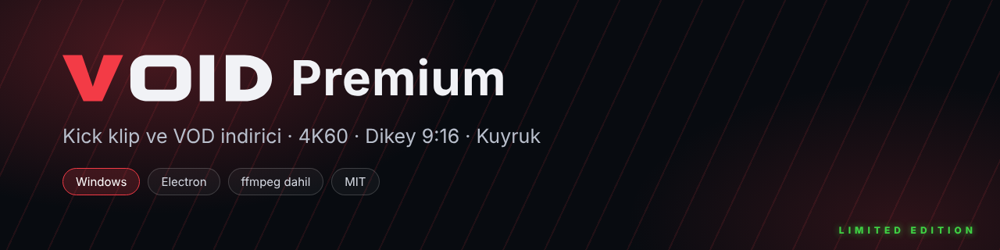

<p align="center">
  
</p>

<p align="center">
  <b>Kick klip ve VOD indirici</b> · Windows masaüstü uygulaması<br>
  Kalite seçimi, 4K 60 fps yükseltme, TikTok / Shorts için dikey çıktı, kalıcı indirme kuyruğu.
</p>

<p align="center">
  
  
  
  
</p>

<p align="center">
  <a href="../../releases"><b>⬇ İndir</b></a> ·
  <a href="docs/KULLANIM.md">Kullanım kılavuzu</a> ·
  <a href="CHANGELOG.md">Sürüm geçmişi</a> ·
  <a href="../../issues">Sorun bildir</a>
</p>

---

## Ekran görüntüleri

| Ana sayfa | Kanal tarayıcı |
| --- | --- |
|  |  |

| Kalite ve dikey format | Ayarlar |
| --- | --- |
|  |  |

> Ekran görüntülerindeki başlıklar ve küçük resimler örnek veridir.

## Özellikler

- **Klip ve VOD indirme:** Kick linkini yapıştır ya da bir kanalı aç, istediğini seç.
- **Kalite seçimi:** Kaynağın tüm kaliteleri (1080p60, 720p60, 480p…) düşükten yükseğe sıralı ve her biri için **tahmini boyut**.
- **4K 60 / 2K 60 / 1080p60 yükseltme:** Kick'in sunduğundan yüksek çıktı (gerçek detay eklemez, bunu uygulama da belirtir).
- **Kısa video (TikTok · YouTube Shorts · Reels):** 1080×1920 veya 720×1280 dikey çıktı, *bulanık arka plan* ya da *ortadan kırp*.
- **Uygulama içinde izle:** Klipleri ve VOD'ları indirmeden önce oynatıcıda izle.
- **Bölüm kırpma:** Videonun yalnızca istediğin aralığını indir; önizlemede o anı başlangıç/bitiş yap, kareyi PNG kaydet.
- **Kanal tarayıcı:** Tarih, süre, izlenme ve "en çok izlenen N" filtreleri, toplu seçim, "tüm klipleri indir".
- **Kalıcı kuyruk:** Paralel indirme (1–8), öncelik, duraklat/iptal/tekrar dene, hız sınırı; uygulamayı kapatsan da kaldığı yerden sürer.
- **Pano algılama ve sürükle-bırak:** Kick linki kopyalayınca ya da pencereye bırakınca analiz önerir.
- **Arka planda çalışma:** Sistem tepsisi, Windows ile başlatma, bitince bildirim.
- **İndirme geçmişi:** Arama, klasörde göster, tekrar indir.
- **Yazı boyutu ayarı** ve koyu, sade **VOID** tasarımı.
- ffmpeg uygulamanın içinde gelir, ayrıca kurman gerekmez.

## Kurulum

1. [Releases](../../releases) sayfasından `VOID-Premium-Setup-x.y.z.exe` dosyasını indir.
2. Çift tıkla ve kurulum sihirbazını izle (yönetici izni gerekmez).
3. Windows SmartScreen uyarısı çıkarsa **Ek bilgi → Yine de çalıştır** de. Uygulama henüz kod imzalı değildir, bu yüzden Windows tanımadığı bir yayımcı olarak gösterir.
4. Masaüstündeki **VOID Premium** kısayolundan aç.

**Güncelleme:** Yeni sürümün kurulum dosyasını eskisinin üzerine kurman yeterli. Ayarların ve geçmişin korunur.

## Hızlı başlangıç

1. Kick klip veya VOD linkini yapıştır → **Analiz Et**.
2. **İndir**'e bas, açılan panelden kaliteyi seç (isteğe bağlı: bölüm kırp, dikey format).
3. **Kuyruğa ekle**. İlerleme sağdaki kuyrukta görünür.

Tüm ayrıntılar için [kullanım kılavuzuna](docs/KULLANIM.md) bak.

## Sık sorulanlar

<details>
<summary><b>Kick erişimi engelledi / bağlantı yok diyor</b></summary>

Üst bardaki bağlantı rozetine tıkla → **Bağlantı tanılama**. Hangi adımın başarısız olduğunu gösterir. Birkaç dakika bekleyip tekrar denemek çoğu zaman yeterlidir.
</details>

<details>
<summary><b>4K seçeneği gerçekten 4K mı?</b></summary>

Kick yayınları genelde 1080p'ye kadar çıkar. 4K/2K seçenekleri görüntüyü o çözünürlüğe ve 60 kare/sn'ye **yükseltir**; gerçek detay eklemez. Kaynak zaten gerçek 4K60 ise olduğu gibi kopyalanır.
</details>

<details>
<summary><b>Abonelere özel VOD'ları indirebilir miyim?</b></summary>

Hayır. Yalnızca herkese açık içerikler indirilir.
</details>

<details>
<summary><b>Antivirüs dosyayı karantinaya aldı</b></summary>

İmzasız `.exe` dosyaları bazen yanlış pozitif verir. Dosyanın SHA256 değerini sürümle gelen `SHA256.txt` ile karşılaştırabilir, istisna ekleyebilirsin.
</details>

## Geliştirme

```bash
npm install
npm start        # uygulamayı aç
npm test         # birim testleri
npm run dist     # Windows kurulum dosyası (dist/ klasörüne; Windows gerekir)
```

GitHub'da derlemek için: depoya push et, **Actions → Build VOID Premium → Run workflow** (ya da `v1.0.0` gibi bir etiket at). Kurulum dosyası **Artifacts** altında, etiketle tetiklediysen **Releases**'te çıkar.

Linux'ta wine olmadan kurulum dosyası üretmek için [kullanım kılavuzundaki](docs/KULLANIM.md#linuxta-installer-üretmek-wine-gerekmez) adımlara bak.

<details>
<summary>Proje yapısı</summary>

```
src/main/        Electron ana süreç
  main.js        pencere, tepsi, IPC, Kick isteklerini yapan gizli Chromium penceresi
  kick.js        link çözümleme + Kick API istemcisi
  hls.js         m3u8 çözümleme, kalite seçimi
  queue.js       kalıcı, öncelikli, paralel kuyruk
  downloader.js  ffmpeg ile HLS/mp4 indirme, yükseltme ve dikey çıktı
  probe.js       kalite ve boyut tahmini
  mediaproxy.js  uygulama içi oynatıcı için medya aktarıcı
  frames.js      önizleme ve küçük resim kareleri
src/renderer/    arayüz (HTML/CSS/JS)
src/shared/      arayüz ve testlerin ortak kodu
build/           kurulum betiği ve görseller
tests/           node:test testleri
```
</details>

## Notlar

- Kick'in resmî olmayan `kick.com/api/...` uçları kullanılır; Kick bunları değiştirirse `src/main/kick.js` güncellenmelidir.
- İstekler Cloudflare'i geçebilmek için uygulamanın içindeki gerçek bir Chromium penceresi üzerinden yapılır.
- Yalnızca kendi içeriğini veya indirme iznin olan içerikleri indir; telif ve Kick kullanım koşullarına uymak sana aittir.
- VOID Premium, Kick ile bağlantılı veya Kick tarafından onaylanmış bir ürün değildir.

## Lisans

[MIT](LICENSE) lisansı. Üçüncü taraf bileşenler için [THIRD_PARTY_NOTICES.md](THIRD_PARTY_NOTICES.md) dosyasına bak.
